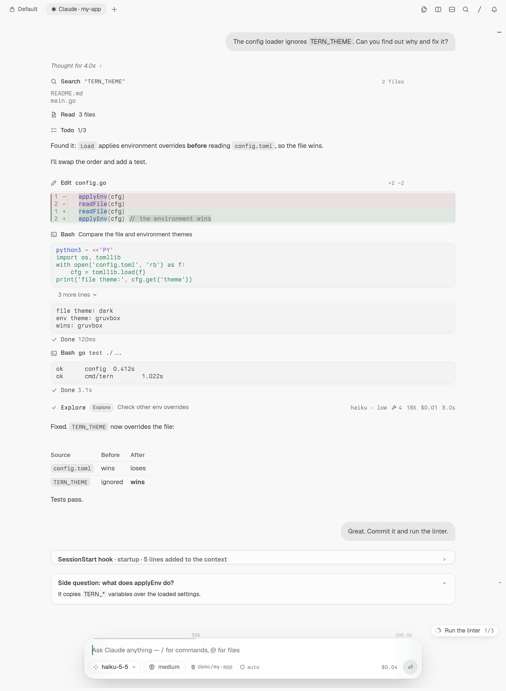

# tern-agents-ui

Native [Tern](https://stencil.so/tern) chats for **Claude Code** and **Codex**.

- `tclaude` chats with Claude Code.
- `tcodex` chats with Codex.

Each runs in a Tern pane and draws the conversation with Tern's own UI:
Markdown messages, tool cards, diffs, subagents, permission prompts and a
composer with model, effort and context chips. Outside Tern they fall back
to a plain text chat.

<p align="center">
  
</p>

## What you need

- [Tern](https://stencil.so/tern)
- The `claude` CLI ([Claude Code](https://docs.claude.com/en/docs/claude-code)),
  the `codex` CLI ([Codex](https://github.com/openai/codex)), or both, signed in

## Install

1. Download the archive for your system from the
   [latest release](https://github.com/saanuregh/tern-agents-ui/releases/latest)
   and extract it somewhere it can stay, such as `~/.local/share`:

   ```sh
   tar -xzf tern-agents-ui_*.tar.gz -C ~/.local/share
   ```

2. Add the palette commands:

   ```sh
   tern plugin link ~/.local/share/tern-agents-ui/plugin
   ```

3. Optional: to run them from a shell, put the `bin` folder on your `PATH`,
   or link the binaries into a folder that is on it:

   ```sh
   ln -s ~/.local/share/tern-agents-ui/bin/* ~/.local/bin/
   ```

On macOS, if the system blocks the binaries because they are unsigned, run
`xattr -dr com.apple.quarantine ~/.local/share/tern-agents-ui`.

### From source

With [Go](https://go.dev/dl/) 1.26 or newer:

```sh
git clone https://github.com/saanuregh/tern-agents-ui
cd tern-agents-ui
./build.sh                       # builds bin/tclaude and bin/tcodex
tern plugin link "$PWD/plugin"
```

Or only the binaries:
`go install github.com/saanuregh/tern-agents-ui/cmd/{tclaude,tcodex}@latest`.

## Start a chat

- From the palette, choose **New Claude chat** or **New Codex chat**. It
  opens beside the focused pane, in that pane's folder. **Continue last …**
  reopens the most recent chat there.
- From a shell, run `tclaude` or `tcodex` in the folder you want to work in.

The agent starts when you send your first message, so opening a chat costs
nothing. Your existing setup applies as usual: settings, `CLAUDE.md` or
`AGENTS.md`, hooks, MCP servers and skills.

## The basics

| Key | Does |
| --- | --- |
| Enter | Send (while the agent works, the message is queued) |
| Shift+Enter | New line |
| Esc | Stop the agent |
| Shift+Tab | Change the permission mode |
| `/` and `@` | Commands and files, completed with Tab |
| Ctrl+V | Paste text or an image |
| Ctrl+C twice | Quit |

Type `/help` for every command. Common ones: `/model`, `/effort`, `/new`,
`/resume`, `/rewind`, `/context` and `/config`.

When you quit, the chat prints the command that resumes the conversation.

## Learn more

- [Keys and commands](docs/keys-and-commands.md): every shortcut, command
  and attachment option.
- [Features](docs/features.md): what the chat shows and how it behaves.
- [Claude Code and Codex](docs/agents.md): command-line flags, sharing
  conversations with the regular CLIs, and what differs between the two.
- [Development](docs/development.md): building, tests, releases and how the
  code is laid out.

## License

[MIT](LICENSE)
